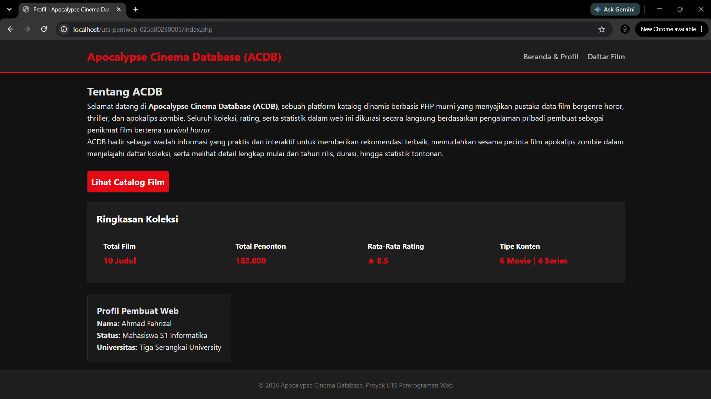
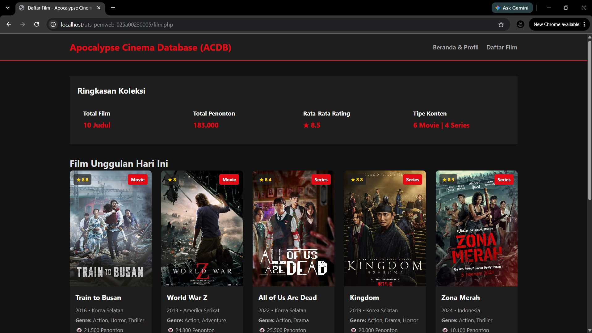

# UTS Pemrograman Web - Proyek Mini Individu

## Identitas
* **Nama  :** Ahmad Fahrizal
* **NIM   :** 025A00230005
* **Kelas :** Pemrograman Web A2-3B S1 Informatika

## Deskripsi Singkat Tema Proyek
Tema yang saya pilih adalah Koleksi Pribadi (film). Judul dari aplikasi web katalog dinamis berbasis PHP murni ini adalah "Apocalypse Cinema Database (ACDB)". Web yang menyajikan pustaka data film bergenre horor, thriller, dan apokalips zombie. Web ini saya bangun untuk memberikan rekomendasi film kepada penikmat film bertema apokalips zombie dalam menjelajahi daftar koleksi film pribadi saya, melihat rating film dari saya, dan melihat deskripsi tahun rilis film.

## Cara Jalankan di Localhost
1. **Jalankan Laragon / Server PHP:**
   Buka aplikasi Laragon, lalu klik tombol **Start All** di bagian bawah panel (atau jalankan `php -S localhost:8000` via terminal).
2. **Struktur Folder Proyek:**
   Pastikan folder proyek berada di direktori `C:\laragon\www\uts-pemweb-025a00230005`.
3. **Akses Melalui Browser:**
   Buka browser dan akses alamat: `http://localhost/uts-pemweb-025a00230005` atau `http://localhost:8000`.

## Fitur & Logika
1. **Struktur Data Terpisah (`data.php`):** Menyimpan 10 koleksi film dalam bentuk array multidimensi yang memuat atribut `id`, `judul`, `tahun`, `genre`, `tipe`, `durasi`, `rating`, `penonton`, `negara`, dan path `poster`.
2. **Logika Bisnis & Kalkulasi (`functions.php`):**
   * Menghitung total judul film dalam katalog.
   * Menghitung akumulasi total penonton secara otomatis.
   * Menghitung rata-rata rating film dengan pembulatan 1 desimal.
   * Mengelompokkan total konten berdasarkan tipe (Movie dan Series).
3. **Keamanan Sanitasi XSS (`e()`):** Penggunaan fungsi `htmlspecialchars()` dengan opsi `ENT_QUOTES` untuk mengamankan pencetakan data ke dalam HTML dari serangan Cross-Site Scripting.
4. **Halaman Katalog Dinamis (`film.php`):** Menampilkan ringkasan statistik koleksi dan *grid layout* kartu film yang di-render dinamis menggunakan perulangan `foreach`.
5. **Halaman Profil (`index.php`):** Menyajikan informasi singkat mengenai platform ACDB serta profil pembuat web.

## Fungsi Array & Bawaan PHP yang Digunakan
* `count()` : Menghitung jumlah elemen/item di dalam array data film.
* `round()` : Membulatkan hasil kalkulasi rata-rata rating film hingga 1 angka di belakang koma.
* `number_format()` : Memformat angka ribuan (seperti total penonton) agar tampil dengan pemisah titik yang rapi.
* `htmlspecialchars()` : Melakukan *escape* karakter khusus HTML untuk keamanan pencetakan data.
* `require` & `__DIR__` : Memanggil file modul `data.php` dan `functions.php` secara terstruktur berdasarkan direktori absolut.

## Tangkapan Layar
### Halaman Utama / Profil (`index.php`)

### Halaman Katalog & Ringkasan Statistik (`film.php`)

## Sumber Referensi & Catatan AI
* Referensi desain UI: Antarmuka bertema platform streaming film lk21.de.
* Referensi nama web: Nama platform Apocalyps "Apocalypse Cinema Database (ACDB)" terinspirasi dari platform imdb.com (Internet Movie Database)
* Pembantu Pengembangan (AI): Menggunakan Gemini AI sebagai teman berdiskusi tentang tampilan css, cara commit git, penyusunan fungsi statistik dan dokumentasi README.